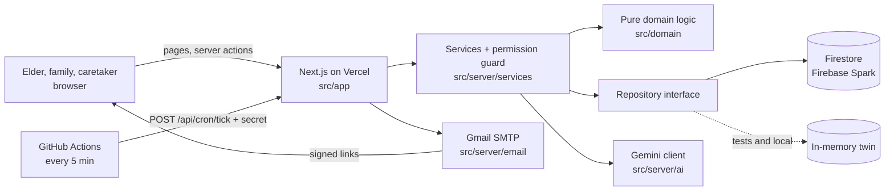

# Kinloop

**The care circle where the elder stays in charge.** Kinloop helps an older person manage daily
medicines, health routines and doctor visits, while the family and caretakers who help them can see
what is done, what is missed and why, and get an email when something needs them.

- **Live app:** https://kinloop-mocha.vercel.app
- **Repository:** https://github.com/jatinvats123/kinloop

## Try it in two minutes

Open the live app and press **Start the demo, no sign-up**. You get your own isolated circle (deleted
after 24 hours) for Kamla Devi (elder), her daughter Priya (edit access) and caretaker Ramesh (view
only), with ten days of history: a missed-evening pattern, one "felt unwell" skip, a slot due now, a
doctor's visit tomorrow and one change waiting for Kamla's approval.

A **Try it in two minutes** panel walks you through seven steps. Each step has a button that takes you
there (switching person when needed) and ticks itself from the activity feed:

1. Take a dose as Kamla (Today)
2. Check a sample label ("Is this the right one?")
3. Change a medicine as Priya (it waits for Kamla, because "Ask me first" is on)
4. Approve it as Kamla
5. Send yourself a test reminder email
6. Import a prescription (one click pastes a sample; you review each AI draft)
7. Open the visit brief for tomorrow's doctor

Then switch to Ramesh, who can see everything but cannot change medicines.

## The problem

Older people often take several medicines at different times, and the family who help them live
elsewhere. Missed or doubled doses go unnoticed, appointments slip, and when the doctor asks "how has
she been?", nobody has the facts. Most reminder apps notify one phone and stop there; they do not
close the loop, and they tend to put the family in charge rather than the elder.

## The principle

**The AI reads and drafts; tested code decides; a person confirms.** Every schedule, status, percentage,
reminder and label verdict comes from pure, unit-tested functions in `src/domain`. Gemini only reads
labels and prescriptions and drafts talking points; it never writes to the database, never produces a
verdict and never gives medical advice. Every AI screen says what the AI did.

## What it does

| Problem statement asks for                   | Feature                                                                                                                                                         | Where                                                                       |
| -------------------------------------------- | --------------------------------------------------------------------------------------------------------------------------------------------------------------- | --------------------------------------------------------------------------- |
| Secure, passcode-based access                | Circle code (`XXXX-XXXX`) + personal 6-digit passcode, scrypt-hashed, lockout after 5 failures, regenerable                                                     | `/sign-in`, `/start`, `src/server/services/circles.ts`                      |
| Elder's healthcare profile                   | Conditions, allergies, blood group, doctor, emergency contact; feeds the visit brief                                                                            | `/circle/profile`, `src/server/services/members.ts`                         |
| Elders, family and caretakers, shared        | Roles `elder` / `family` / `caretaker`, access `view` / `edit`, organisers, alert choices                                                                       | `/circle`, `src/domain/permissions.ts`                                      |
| View, add, edit, manage medication schedules | One model for medicines **and** routines (BP checks, walks): times, weekdays, start/end, pause                                                                  | `/medicines`, `src/server/services/items.ts`, `src/domain/schedule.ts`      |
| Track adherence                              | 7/30-day percentages overall and per item, streak, most-missed part of day, week strip of blooms                                                                | `/adherence`, `/overview`, `src/domain/adherence.ts`                        |
| Monitor upcoming appointments                | Visits with **Add to Google Calendar** links                                                                                                                    | `/appointments`, `src/domain/calendar-link.ts`                              |
| Email reminders: upcoming doses              | Elder emailed 10 minutes before each slot, with a one-tap confirm link                                                                                          | `src/domain/reminders.ts`, `src/server/reminders/tick.ts`                   |
| Email reminders: missed medications          | Elder nudged at T+30 min; opted-in members at T+60 min                                                                                                          | same, plus `/reminders` (log and test email)                                |
| Email reminders: appointments                | 24 h and 2 h before each visit                                                                                                                                  | same                                                                        |
| Elder at the centre of decisions             | **Today** is elder-first (large type, one action per slot, skip with a reason, read-aloud, text size); **Ask me first** turns others' changes into proposals    | `/today`, `src/server/services/proposals.ts`                                |
| Keep family and caretakers informed          | Overview with today's status, flagged skips ("felt unwell", "ran out"), activity feed                                                                           | `/overview`, `/activity`                                                    |
| Smarter                                      | **Is this the right one?** right-medicine check; prescription import                                                                                            | `/check`, `src/domain/label-match.ts`, `/medicines/import`                  |
| Collaborative                                | "I'll check on her": the first member to answer an escalation is shown to everyone as handling it                                                               | `/check-on`, `src/server/services/links.ts`                                 |
| Reliable                                     | Window-based, idempotent reminder engine; claim-before-send; one email per member per slot per stage                                                            | `src/server/reminders/tick.ts`                                              |
| More useful doctor visits                    | **Visit brief**: adherence, missed doses, skip reasons, readings, schedule and profile computed by code, plus AI-drafted points to mention and questions; print | `/appointments/[id]/brief`, `src/domain/visit-brief.ts`                     |
| Easy to evaluate                             | Instant demo with a self-ticking guided tour                                                                                                                    | `src/server/services/demo.ts`, `src/domain/tour.ts`, `src/components/shell` |

## What makes it different

- **Right-medicine check.** Before a dose, the elder photographs the strip. Gemini only reads the label
  (brand, ingredients, strengths); tested code compares it with the schedule and answers in very large
  type: _Yes, this is your 2:00 PM Amlodipine 5 mg_ / _Not now, this is for 8:00 PM_ / _You already took
  this at 8:05 AM_ / _Different strength_ / _Not on your list_ / _Couldn't read it_. It always says
  "matches your schedule", never "safe to take". Code: `src/domain/label-match.ts`,
  `src/server/services/label-check.ts`.
- **Ask me first.** The elder can require approval: schedule changes by anyone else become proposals
  she approves or declines on Today. Code: `src/server/services/proposals.ts`.
- **Closed-loop reminders.** The elder is always told first; the circle hears only if a dose is still
  not marked an hour later. A signed link confirms the dose in one tap (opening the link changes
  nothing; only the button does, because mail scanners prefetch links), and "I'll check on her" lets
  the family see that someone has it. Code: `src/domain/reminders.ts`, `src/server/security/signed-link.ts`.

## Google services

| Service                              | What for                                                                                                          | Where                                                                                              |
| ------------------------------------ | ----------------------------------------------------------------------------------------------------------------- | -------------------------------------------------------------------------------------------------- |
| Gemini API (`@google/genai`), vision | Reading medicine labels and prescription photos                                                                   | `src/server/ai/client.ts`, `src/server/ai/label-reader.ts`, `src/server/ai/prescription-reader.ts` |
| Gemini API, text                     | Pasted prescriptions; drafting visit-brief talking points from computed facts                                     | `src/server/ai/prescription-reader.ts`, `src/server/ai/brief-writer.ts`                            |
| Firestore (Firebase, Native mode)    | All data, server-side only through `@google-cloud/firestore`                                                      | `src/server/repositories/firestore-repository.ts`                                                  |
| Gmail SMTP                           | Every reminder, escalation and test email (Nodemailer, app password)                                              | `src/server/email/`                                                                                |
| Google Fonts                         | Urbanist through `next/font`                                                                                      | `src/app/layout.tsx`                                                                               |
| Google Calendar                      | "Add to Google Calendar" event links for visits                                                                   | `src/domain/calendar-link.ts`                                                                      |
| Cloud Run-ready container            | Documented production path: multi-stage, non-root `Dockerfile`, `/api/health`; deploy command in `docs/DEPLOY.md` | `Dockerfile`, `src/app/api/health/route.ts`                                                        |

The live app is hosted on Vercel; Cloud Run is the documented path, not what serves the demo today.

## Architecture



Layer rules (dependencies point downward only):

```
src/app/          routes, pages and thin server actions
src/components/   UI: primitives (ui/), signature pieces (signature/), screens
src/server/       auth, services, repositories, AI, email, reminders, security
src/domain/       pure functions and types: schedule, status, adherence, reminder ladder,
                  label matching, visit-brief facts, tour progress, permissions
```

- `src/domain` imports nothing from the other layers and does no I/O.
- Every service calls `requirePermission` (one `can()` function) before it reads or writes; the circle
  code always comes from the signed session, never from client input.
- Doses are never stored ahead of time: slots are derived from items for any date range in the circle's
  IANA timezone. Logs have a deterministic ID (`item_slotInstant`), so logging twice never duplicates.

## Security

Full list with file paths in [SECURITY.md](SECURITY.md). Highlights:

- scrypt passcodes with per-member salt and `timingSafeEqual`; lockout stored in Firestore
  (`src/server/auth/passcode.ts`, `src/server/services/circles.ts`)
- signed httpOnly `SameSite=Lax` session cookie, 12 h, ended by passcode regeneration
  (`src/server/auth/session.ts`)
- authorisation-denial test for every mutating service (`src/server/services/services.test.ts`)
- nonce CSP, HSTS, `nosniff`, `frame-ancestors 'none'`, Referrer-Policy, Permissions-Policy and an
  origin check on state-changing requests (`src/proxy.ts`, `src/server/security/`)
- HMAC-signed email links bound to circle, slot, member and purpose (`src/server/security/signed-link.ts`)
- AI input treated as data, output forced to a JSON schema and re-checked with Zod, images checked by
  magic bytes, daily AI quota (`src/server/ai/`)
- `npm audit`: 0 vulnerabilities

## Accessibility

WCAG 2.2 AA as the floor; elder screens aim higher. Skip link, landmarks, one `h1` per page, labelled
inputs with linked errors, visible focus, full keyboard use (focus moves to the right-medicine verdict),
targets of 44 px (56 px for elder actions), status always as icon + text, `aria-live` updates, reduced
motion respected, no horizontal scroll from 320 px. Every text colour pair is checked by a contrast test
(`src/components/ui/tokens.test.ts`, at least 7:1 on elder screens) and component tests run axe with
zero violations (`src/test/axe.ts`, `src/components/*.test.tsx`).

## Efficiency

- Server components for reads; client JavaScript only for interactive controls.
- One bounded query per collection per page, run in parallel (`src/server/services/read-models.ts`);
  every list query has a limit (`src/server/repositories/firestore-repository.ts`).
- Batched log writes; the cron tick visits only circles with an email, with bounded concurrency
  (`src/server/concurrency.ts`) and a time budget (`src/server/reminders/tick.ts`).
- AI only on an explicit action; the visit brief draft is cached by a SHA-256 of its facts
  (`src/server/services/visit-brief.ts`).

## Testing

```bash
npm run check   # ESLint (zero warnings) + TypeScript strict + Vitest with coverage thresholds
```

Last run: **339 tests in 34 files, all passing; 95.8 % line coverage overall, 99.7 % in `src/domain`**.
Thresholds are enforced in `vitest.config.mts` (`src/domain` ≥ 95 % lines, overall ≥ 85 %). Tests never
touch the network: the in-memory repository and a mocked AI client stand in. Covered edge cases
include midnight and timezone boundaries, end dates, paused items, duplicate logging, cron idempotency,
lockout, label matching (brand vs generic, salts, strength mismatch, double dose), hostile and malformed
AI output, mail failure and session invalidation. CI runs the same check on every push
(`.github/workflows/ci.yml`).

## Run it locally

```bash
npm install
cp .env.example .env.local   # set DATA_BACKEND=memory and SESSION_SECRET, LINK_SECRET, CRON_SECRET (32+ random bytes)
npm run dev                  # in-memory data, no cloud needed; AI features say they are unavailable without GEMINI_API_KEY
```

## Deployment

Vercel (Hobby) + Firestore on the free Firebase Spark plan, with a GitHub Actions schedule calling
`POST /api/cron/tick` every five minutes using a shared secret (`.github/workflows/cron.yml`). The
container is Cloud Run-ready. Step-by-step: [docs/DEPLOY.md](docs/DEPLOY.md).

## Challenges and how we handled them

| Challenge                                                                                                   | What we did                                                                                                                                                                                                                          | Where                                                                                   |
| ----------------------------------------------------------------------------------------------------------- | ------------------------------------------------------------------------------------------------------------------------------------------------------------------------------------------------------------------------------------ | --------------------------------------------------------------------------------------- |
| No Google Cloud billing on the account, so Cloud Run, Cloud Scheduler and Secret Manager were not available | Hosted on Vercel with Firestore on the free Firebase Spark plan and secrets in environment variables; kept a multi-stage, non-root `Dockerfile` and `/api/health` so the same app moves to Cloud Run unchanged                       | `Dockerfile`, `docs/DEPLOY.md`                                                          |
| GitHub's scheduled workflows can run late or be skipped, which could delay or repeat reminders              | Made the reminder engine window-based and idempotent: each email is claimed before it is sent, a late tick still sends each due email exactly once, slots older than six hours are skipped, and the workflow can also be run by hand | `src/domain/reminders.ts`, `src/server/reminders/tick.ts`, `.github/workflows/cron.yml` |
| A blurry or partial photo could make the AI misread a medicine label                                        | The AI only reads; tested code decides. Low-confidence or unreadable labels get "Couldn't read it. Try again in better light.", never a guess, and the answer always says "matches your schedule", never "safe to take"              | `src/domain/label-match.ts`                                                             |
| The first Gemini model took 12–16 s from Vercel and hit rate limits                                         | Switched to a faster Flash-Lite model with minimal thinking (about 2 s per label), with a 20 s timeout, one retry and a calm fallback message                                                                                        | `src/server/ai/client.ts`                                                               |
| Member email addresses are not verified, so a wrong address could receive reminders                         | Emails go only to addresses members enter for themselves, use fixed templates with escaped content, and are capped per circle per day; test emails are rate-limited per member and per IP                                            | `src/server/email/`, `src/server/services/reminders.ts`                                 |
| Elders may prefer a language other than English                                                             | Every elder-facing string goes through one typed message dictionary, so adding Hindi needs no screen changes                                                                                                                         | `src/domain/messages/`                                                                  |

## Next steps

Hindi for elder screens and emails, refill forecasts with a low-stock email, a daily "how are you
feeling" check-in that feeds the visit brief, and a production move to Cloud Run with Cloud Scheduler.

## Licence

MIT
